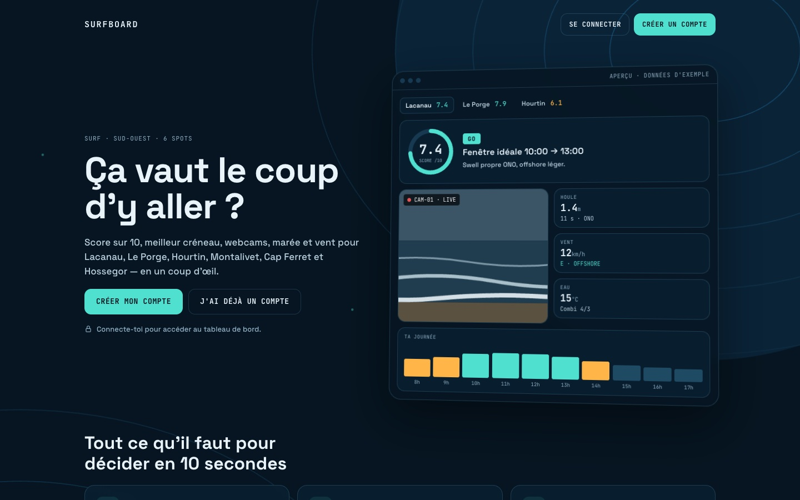
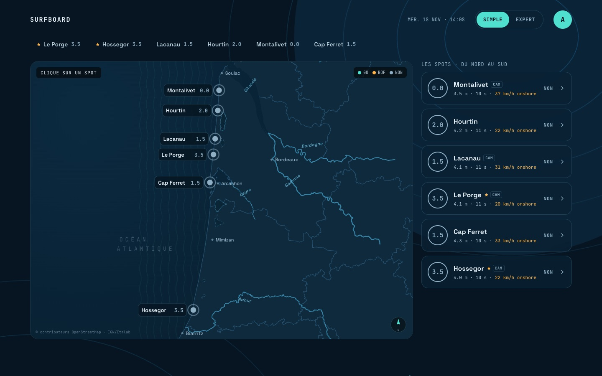
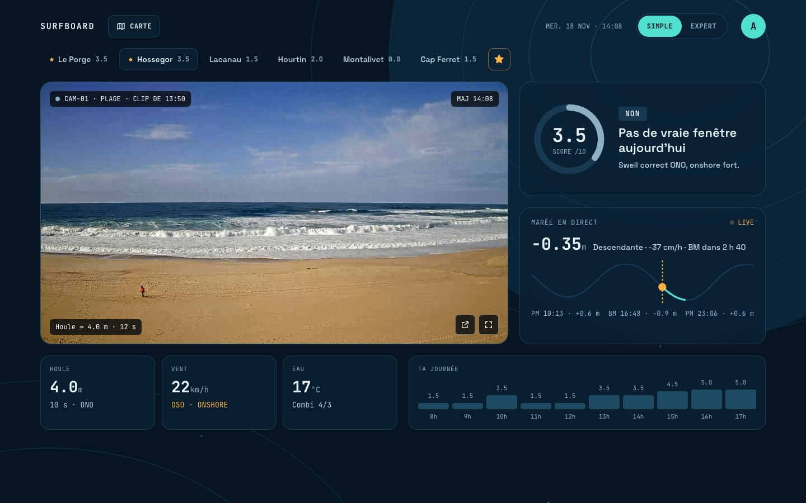
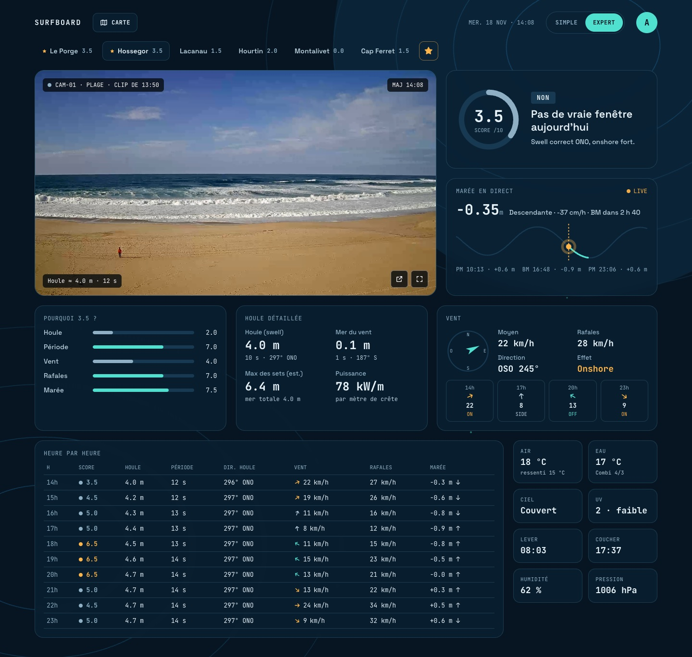
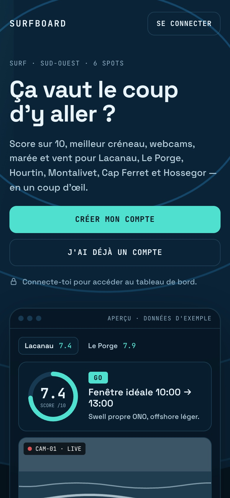
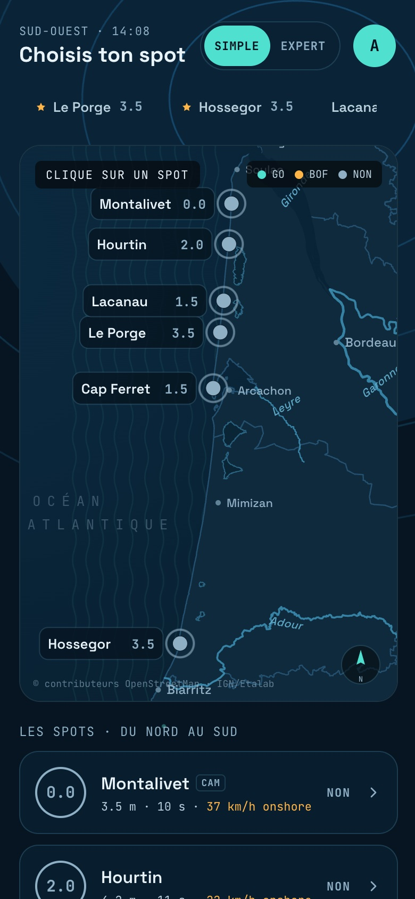
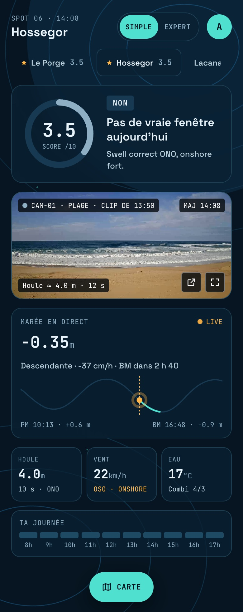
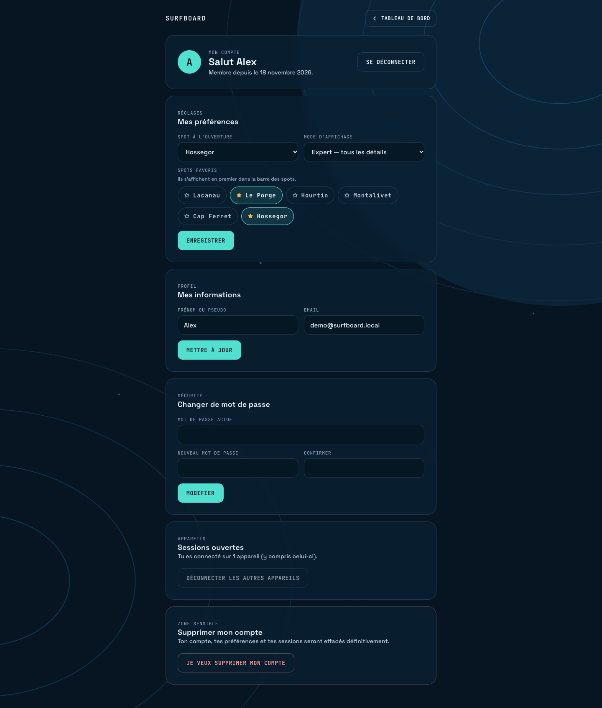

# 🏄 Surfboard

Dashboard surf self-hosté — **ça vaut le coup d'y aller ?**

Surfboard affiche les conditions de surf (houle, période, vent, marée, météo) pour les spots du Sud-Ouest, avec un score sur 10, le meilleur créneau de la journée, les webcams des plages et une carte interactive de la côte.

## Captures

### Carte du Sud-Ouest
Choisis ton spot sur la carte : zoom animé jusqu'à la plage, puis toutes les infos.

### Mode Simple — l'essentiel en un coup d'œil
Score et verdict, meilleure fenêtre, webcam avec l'heure du clip, marée en direct, houle / vent / eau et score heure par heure.

### Mode Expert — tous les détails
Détail du score, houle et mer du vent, puissance, vent heure par heure, tableau complet et météo.

### Sur mobile

| Accueil | Carte | Spot |
|:---:|:---:|:---:|
|  |  |  |

### Mon compte
Spot à l'ouverture, mode d'affichage, favoris, mot de passe, appareils connectés.

## Fonctionnalités

- **Score sur 10 + verdict** — GO / BOF / NON, avec la fenêtre idéale et l'heure où ça se dégrade
- **6 spots** — Montalivet, Hourtin, Lacanau, Le Porge, Cap Ferret, Hossegor
- **Carte interactive** — côte du Sud-Ouest avec Garonne, Dordogne, estuaire et lacs ; zoom animé vers le spot
- **Modes Simple / Expert** — l'essentiel ou tout le détail
- **Webcams à jour** — le dernier clip de chaque caméra est retrouvé côté serveur, avec son heure de capture (alerte si l'image est ancienne ou de nuit)
- **Marée en direct** — niveau, sens, vitesse, prochaine pleine / basse mer
- **Comptes** — favoris, spot par défaut et mode synchronisés sur tous les appareils
- **Animations** — apparitions en cascade, fond océan animé (désactivées si « réduire les animations » est activé)
- **PWA** — installable sur téléphone

## Stack technique

| Composant | Technologie |
|-----------|-------------|
| Frontend | SvelteKit 2 + Svelte 5 |
| Données météo | Open-Meteo API (gratuit, sans clé) |
| Données marines | Open-Meteo Marine API |
| Comptes | SQLite intégré à Node (`node:sqlite`), mots de passe scrypt, sessions en cookie httpOnly |
| Carte | SVG maison — contours IGN/Etalab, hydrographie OpenStreetMap |
| Webcams | Viewsurf & Skaping (résolution du dernier clip côté serveur) |
| Hébergement | Self-hosté sur Proxmox |
| Accès distant | Cloudflare Tunnel |

## Installation

Prérequis : **Node.js 22.13+** (pour `node:sqlite`)

    git clone https://github.com/ANdroxee/Surfboard.git
    cd Surfboard
    npm install
    npm run dev

Dashboard accessible sur http://localhost:5173 — crée un compte pour accéder au tableau de bord.

### Production

    npm run build
    ORIGIN=https://ton-domaine.fr node build

| Variable | Rôle |
|----------|------|
| `ORIGIN` | URL publique du site (obligatoire derrière un proxy / Cloudflare Tunnel, sinon les formulaires sont refusés) |
| `ADDRESS_HEADER` | `cf-connecting-ip` derrière Cloudflare, pour limiter les tentatives de connexion par vraie IP |
| `DATABASE_PATH` | Fichier SQLite des comptes (défaut : `data/surfboard.db`) — à placer sur un volume persistant |

## Score surf

Le score est calculé sur 10 :

| Critère | Idéal | Bonus | Malus |
|---------|-------|-------|-------|
| Houle | 0.5-1.5m | +2 | -2 si flat ou > 3m |
| Période | 12s+ | +1.5 | -1 si < 6s |
| Vent | Offshore (Est) | +1.5 | -2 si onshore fort |
| Rafales | < 8 kn | +0.5 | -1.5 si > 30 kn |

Ajuste `surfScore()` dans `src/lib/api.js` selon ton niveau.

## Données et crédits

- [Open-Meteo](https://open-meteo.com/) — météo et données marines
- [Viewsurf](https://www.viewsurf.com/) et [Skaping](https://www.skaping.com/) — webcams
- [OpenStreetMap](https://www.openstreetmap.org/copyright) (ODbL) — rivières, estuaire, lacs
- [france-geojson](https://github.com/gregoiredavid/france-geojson) (IGN / Licence Ouverte Etalab) — contours des départements

## Licence

MIT
